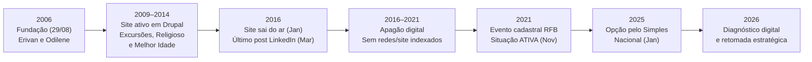

# Dossiê Histórico e Analítico — São Bento Turismo (Fortaleza/CE)

> [!NOTE]
> Pesquisa realizada em **24/11/2026** com base em dados públicos abertos (Receita Federal via BrasilAPI, Registro.br RDAP, Internet Archive / Wayback Machine, diretórios empresariais e buscadores), cruzada com o relatório estratégico anexado (*Análise de concorrência e diagnóstico digital — Out/2026*).

---

## 1. Ficha Cadastral Oficial (Receita Federal)

Os dados públicos da Receita Federal confirmam e aprofundam o perfil empresarial localizado parcialmente no PDF:

| Campo | Dado Oficial (RFB) |
| :--- | :--- |
| **Razão Social** | `SAO BENTO VIAGENS, PEREGRINACOES & TURISMO LTDA` |
| **Nome Fantasia** | `S B TURISMO` |
| **CNPJ** | `08.322.444/0001-55` (Matriz) |
| **Data de Abertura** | `29/08/2006` (20 anos de fundação em 2026) |
| **Natureza Jurídica / Porte** | Sociedade Empresária Limitada (`206-2`) • Microempresa (ME) |
| **Capital Social** | R\$ 20.000,00 |
| **Situação Cadastral** | **ATIVA** (data do último evento cadastral: `08/11/2021`) |
| **Regime Tributário** | Optante pelo **Simples Nacional** desde `01/01/2025` |
| **CNAE Principal** | `7911-2/00` — Agências de viagens |
| **CNAEs Secundários** | `7912-1/00` (Operadores turísticos) • `7990-2/00` (Serviços de reservas e outros serviços de turismo) |
| **Endereço Oficial (RFB)** | Rua Olegário Memória, 2495, Comp. D — Bairro Edson Queiroz, Fortaleza/CE, CEP `60833-045` |
| **Telefone (RFB)** | `(85) 9987-6437` *(formato antigo de 8 dígitos; atual: `(85) 99987-6437`)* |
| **E-mail (RFB)** | Não informado (`null`) |

### Quadro Societário (Empresa Familiar desde 2006)
* **Antonio Erivan Cordeiro de Aquino** — Sócio-Administrador (entrada em `29/08/2006`, faixa etária 61–70 anos). Registros públicos no Ceará o associam à atuação como **Guia de Turismo** e à organização de eventos/retiros comunitários católicos em Fortaleza.
* **Maria Odilene Costa de Aquino** — Sócia (entrada em `29/08/2006`, faixa etária 51–60 anos).

> [!IMPORTANT]
> **Explicação da divergência de endereços apontada no PDF:** A Receita Federal registra o endereço no bairro **Edson Queiroz**, enquanto a base dos Correios classifica o CEP `60833-045` (Rua Coronel Olegário Memória, 2495) como **Sapiranga-Coité** (região limítrofe). As coordenadas do mapa incorporado no antigo site da empresa (`-3.79053, -38.47528`) confirmam que a agência opera na mesma região desde o início da década de 2010 — a cerca de 600 m da concorrente de nicho *Vallendar Travel* (Av. Washington Soares, 3663).

---

## 2. Resgate do Site Histórico (`saobentoturismo.com.br`)

Embora o diagnóstico de out/2026 não tenha encontrado um site ativo nas buscas atuais, a pesquisa no **Internet Archive (Wayback Machine)** recuperou o site institucional histórico oficial da empresa: **`http://saobentoturismo.com.br`** (construído em Drupal, com copyright `2009–2011` e capturas ativas entre **abril/2011 e dezembro/2014**, saindo do ar com erro HTTP 401 em **janeiro/2016**).

### Identidade e Posicionamento Históricos (Página `/quem-somos`)
* **Slogan histórico:** *"Trabalhando Para Melhor Servir"*
* **Assinatura institucional:** *"Erivan e Odilene"*
* **Credenciamento:** Declarava-se credenciada no Ministério do Turismo (Cadastur) à época.
* **Proposta central:** *"Atua principalmente na **FORMAÇÃO DE GRUPOS DE VIAGENS**"* nos segmentos **cultural, religioso, pedagógico, congressos, negócios e lazer**.
* **Diferencial histórico relevante (não identificado no PDF):** A própria agência destacava sua **"ampla experiência e habilidade com grupos de terceira idade"** e mantinha uma seção dedicada ao programa federal **Viaja Mais Melhor Idade** (`/excursoes/melhoridade`).

### Portfólio Real de Excursões Operadas (2011–2014)
O histórico de saídas arquivadas no site comprova o DNA operacional da empresa em **excursões rodoviárias/aéreas em grupo saindo de Fortaleza**:

| Linha de Produto | Excursões Reais Registradas no Site Histórico |
| :--- | :--- |
| **Turismo Religioso & Peregrinações** | • **Círio de Nazaré – Romaria da Fé** (Belém/PA, 6 dias — out/2014) • **Paixão de Cristo / Semana Santa – Recife e Nova Jerusalém** (PE, duas saídas em abr/2014) • **Juazeiro do Norte, Crato e Barbalha** — Show e Missa Pe. Reginaldo Manzotti (set/2013) • **Canindé – Cidade da Fé** (bate-volta — out/2013 e nov/2014) • **Quixadá – Santuário N. S. Imaculada Rainha do Sertão e Açude do Cedro** (mai/2011 e mai/2014) • **Grande Roteiro Nacional de 20 dias** (jul/2011): Salvador, Rio, **Aparecida**, Curitiba, Blumenau, Serras Gaúchas, Foz, Goiânia e Brasília |
| **Eventos Culturais & Sazonais** | • **O Maior São João do Mundo – Campina Grande (PB)** (2 saídas simultâneas em jun/2014) |
| **Lazer, Litoral & Serra (CE / PI)** | • **Jericoacoara** (*"O Paraíso Existe"* / *"Paraíso Encantado"* — saídas recorrentes de fim de semana, sex 18h a dom 20h, múltiplas vezes ao ano) • **Serra da Ibiapaba / Carnaval de Serra** (Ubajara, Viçosa, Tianguá e São Benedito — set/2013 e mar/2014) • **Delta do Parnaíba – Luís Correia (PI)** (jan/2014) • **Guaramiranga – A Suíça Cearense** (jan/2014) • **Bate-voltas no Litoral Cearense:** Canoa Quebrada (jan/2013), Praia de Mundaú (fev/2014), Praia de Águas Belas – Cascavel (dez/2013) |

---

## 3. Linha do Tempo Digital e Cadastral (2006–2026)

---

## 4. Auditoria de Presença Atual, Reputação e Homônimos

* **Domínio oficial (`saobentoturismo.com.br`):** Consulta direta ao **RDAP do Registro.br** retornou `404 Não Localizado` — o domínio original da marca **está expirado/disponível para novo registro**.
* **Redes Sociais (Instagram / Facebook / LinkedIn):** Não há perfis ativos indexados sob o nome exato *"São Bento Turismo"* ou *"S B Turismo"* em Fortaleza, exceto o registro antigo no LinkedIn (mar/2016) já citado no PDF.
* **Reputação Online (Reclame Aqui, TripAdvisor, Google):** **Zero passivo reputacional localizado.** Não foram encontradas reclamações ativas no Reclame Aqui nem ocorrências negativas indexadas para o CNPJ `08.322.444/0001-55`. O desafio é exclusivamente de **invisibilidade digital**, não de recuperação de imagem.
* **Cadastur:** Não há indexação direta do CNPJ em buscas abertas — continua exigindo consulta manual direta no portal oficial do Ministério do Turismo (`cadastur.turismo.gov.br`).

> [!WARNING]
> **Cuidado com Homônimos nas Buscas:**
> * **`sbturismo.com.br`** (arquivado em 2016–2017): pertencia a outra agência (*SB Turismo*, Vila Velha/ES, DDD 27) — **sem relação** com a empresa de Fortaleza.
> * **Grupo SB Travel** (Av. Dom Luís, Meireles, Fortaleza): agência corporativa distinta.
> * **Viação São Bento** (SP/MG) e **Viação São Benedito** (CE): empresas de transporte rodoviário distintas.
> * **Mosteiro de São Bento de Fortaleza** (Paupina/Messejana): instituição beneditina sem vínculo societário confirmado.

---

## 5. Operação Atual Confirmada (Calendário Nov/2026 – Mai/2027)

Com base na divulgação oficial via WhatsApp do proprietário, a **São Bento Turismo** opera hoje de forma muito mais ampla do que a hipótese restrita a peregrinações levantada inicialmente no PDF — mantendo um **calendário robusto de 18 saídas programadas em 6 meses**, porém concentrado em *dark social* (WhatsApp e boca a boca).

### Contatos Oficiais Atuais vs. Cadastros Públicos
* **WhatsApp / Reservas atuais (confirmados pelo proprietário):** `(85) 98711-0452` e `(85) 98127-5100`
* **Gap crítico de descoberta:** Nenhum dos dois números atuais está indexado em buscas públicas na internet, enquanto a Receita Federal e diretórios empresariais ainda exibem o número antigo `(85) 99987-6437` (`9987-6437`). Qualquer cliente que busque a agência no Google hoje corre o risco de cair em contato desatualizado.

### Arquitetura Real do Portfólio Atual (4 Linhas de Produto)

| Linha de Produto | Destinos Confirmados (Nov/2026 – Mai/2027) | Papel Estratégico |
| :--- | :--- | :--- |
| **1. Bate-voltas & Fins de Semana (CE)** | Guaramiranga e Pacoti • Camocim • Pontal do Maceió (Fortim) • Ponta Grossa (Icapuí) • Jericoacoara • Mundaú e Flecheiras | **Porta de entrada / Alto giro:** menor ticket, ideal para captar novos clientes e gerar primeiras avaliações no Google. |
| **2. Excursões Rodoviárias Nordeste & Termas** | Canoa Quebrada + Serra do Martins + Mossoró/Hotel Thermas *(2 saídas, incl. Réveillon 2027)* • São Miguel do Gostoso + Shui Brasil • Aracaju • Maragogi • Petrolina e Juazeiro/BA *(Carnaval)* • Chapada das Mesas – Carolina (MA) • Parnaíba e Lençóis Maranhenses | **Motor principal de receita:** viagens de 3 a 6 dias em feriados e férias, com capacidade para múltiplas saídas simultâneas (ex.: 26–30/05). |
| **3. Turismo Religioso & Peregrinações** | Cimbres e Terra da Misericórdia (PE) • Circuito da Fé SP: Campos do Jordão, Aparecida, Guaratinguetá, São Frei Galvão e Canção Nova | **Nicho de identidade e fidelização:** preserva a raiz histórica da marca com grupos recorrentes. |
| **4. Especiais, Eventos & Aéreo** | Brasília *(Posse Presidencial — jan/2027)* • Foz do Iguaçu, Argentina e Paraguai *(aéreo — abr/2027)* | **Ticket médio elevado:** amplia margem e atende clientes já fidelizados que desejam destinos mais distantes. |

### Tom de Voz e DNA de Comunicação
* Linguagem popular, calorosa e comunitária (*"🤩 VAMOS VIAJAR MEU POVO"*, *"Divulgue com seus familiares e amigos"*, *"Viajar é com a São Bento Turismo"*), muito alinhada à venda consultiva de grupos e à indicação familiar.

---

## 6. Como esta Pesquisa Enriquece e Atualiza o Diagnóstico do PDF

1. **Redefinição do posicionamento:** O PDF tratava *"peregrinações"* como hipótese principal. O cruzamento do histórico (2011–2014) com o calendário atual (2026–2027) confirma que o verdadeiro core da São Bento é **Agência de Excursões em Grupo saindo de Fortaleza**, estruturada em **4 pilares claros** (Passeios CE, Excursões Nordeste, Turismo Religioso e Viagens Especiais/Aéreas), com tradição no acolhimento de famílias e melhor idade.
2. **Reclassificação dos concorrentes diretos (do PDF):** Com esse portfólio amplo, os benchmarks mais diretos no raio de 10 km passam a ser **Social Turismo** (grupos, calendário de saídas, pacotes nacionais/internacionais — 1.042 avaliações) e **Prados Turismo** (excursões rodoviárias/aéreas via WhatsApp — 614 avaliações), além de **Fasan Tur** (excursões + religioso — 190 avaliações) e **Vallendar Travel** (apenas no recorte de peregrinações).
3. **Ativo imediato para o Plano de 90 dias:** A agência já tem o que muitas concorrentes demoram a construir — **um calendário real de 6 meses de saídas**. Basta transformar essa lista de WhatsApp em: (a) páginas/fichas individuais no site (`saobentoturismo.com.br`, domínio disponível no Registro.br), (b) destaques organizados por mês no Instagram e (c) posts/eventos no Perfil da Empresa no Google.
4. **Saneamento urgente de contatos e base:** Substituir o telefone antigo `(85) 99987-6437` pelos números atuais `(85) 98711-0452` / `(85) 98127-5100` em todos os canais (Google Maps, diretórios e Receita Federal), cadastrar e-mail oficial na RFB e padronizar o endereço (*Rua Coronel Olegário Memória, 2495 — Sapiranga/Edson Queiroz*).
5. **Sinal de retomada formal (2025):** A opção pelo Simples Nacional em `01/01/2025`, somada à agenda cheia de 2026/2027, confirma que o negócio está em expansão e pronto para converter o fluxo de grupos em prova social digital (avaliações no Google e depoimentos).
